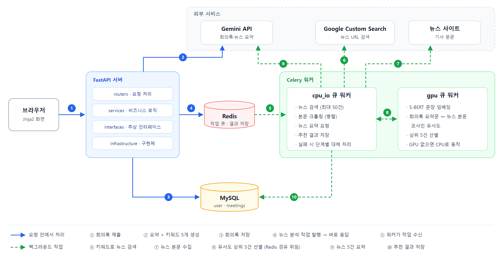
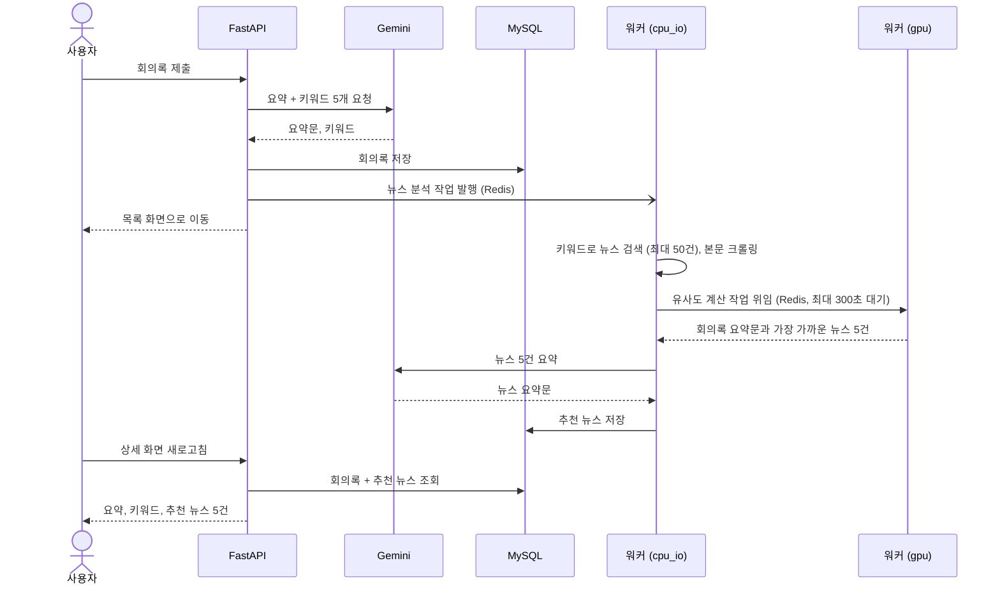

# 회의록 기반 뉴스 추천 시스템

회의록을 입력하면 생성형 AI가 요약과 핵심 키워드를 뽑고, 회의 내용과 의미가 가까운 관련 뉴스 5건을 골라 요약해 주는 웹 서비스입니다.

## 개요

회의록 원문을 Gemini로 요약하고 핵심 키워드 5개를 추출합니다. 이 키워드로 뉴스를 검색해 본문을 수집한 뒤, 문장 임베딩 모델(S-BERT)로 회의록 요약문과 각 뉴스 본문의 의미 유사도를 계산해 가장 가까운 5건을 고릅니다. 고른 뉴스는 다시 Gemini로 3~4문장씩 요약해 회의록과 함께 보여 줍니다.

뉴스 검색부터 요약까지는 시간이 오래 걸리기 때문에, 회의록 저장 요청과 분리해 Celery 백그라운드 작업으로 처리합니다.

## 팀 구성과 역할

2025년 학부 소프트웨어 아키텍처 수업의 3인 팀 프로젝트입니다. (2025.11 ~ 2025.12, 4주)

| 담당 | 범위 |
|---|---|
| 신홍규 ([@lunxkoe](https://github.com/lunxkoe)) | 백엔드와 AI 처리 흐름 전체 설계·구현 — API 서버, 계층 구조, DB, Celery 작업 큐, 외부 API 연동, S-BERT 유사도 선별 |
| 팀원 | 화면(Jinja2 템플릿) |

## 주요 기능

- 회원가입, 로그인, 로그아웃 (세션 기반, 비밀번호 bcrypt 해시)
- 회의록 등록: Gemini로 요약문과 핵심 키워드 5개 생성
- 관련 뉴스 추천: 키워드로 뉴스 검색 → 본문 수집 → 의미 유사도 상위 5건 선별 → 뉴스별 요약
- 회의록 목록·상세 조회, 삭제 (본인 회의록만)
- 뉴스 분석 재시도: 추천 결과를 비우고 분석 작업을 다시 실행

## 시스템 아키텍처



- **FastAPI 서버**: 화면 렌더링, 회원·회의록 처리. 회의록 요약은 요청 안에서 처리하고, 뉴스 분석은 작업만 발행한 뒤 바로 응답합니다.
- **Celery 워커 (cpu_io 큐)**: 뉴스 검색, 본문 크롤링, 뉴스 요약, DB 저장처럼 외부 호출이 많은 작업을 맡습니다.
- **Celery 워커 (gpu 큐)**: S-BERT 임베딩과 유사도 계산만 따로 맡습니다. 무거운 연산을 별도 큐와 워커로 분리했습니다.
- **Redis**: Celery 브로커이자 결과 저장소입니다.

### 계층 구조

서비스 계층은 `domain/interfaces`의 추상 인터페이스에만 의존하고, 실제 구현체(MySQL, Gemini, Google Search, newspaper3k)는 `infrastructure`에 두었습니다. 구현체 조립은 FastAPI의 `Depends`로 `api/dependencies.py`에서 합니다.

```
api/routers  →  services  →  domain/interfaces  ←  infrastructure
(요청 처리)     (비즈니스 로직)   (추상 인터페이스)       (DB·외부 API 구현체)
```

## 기술 스택

| 분류 | 기술 |
|---|---|
| 언어 | Python 3.10 |
| 웹 | FastAPI 0.111, Jinja2, Starlette 세션 |
| DB | MySQL 8, SQLAlchemy 2.0 (async, aiomysql) / PyMySQL (워커) |
| 비동기 작업 | Celery 5.4, Redis |
| LLM | Google Gemini (`gemini-2.5-flash-lite`, google-genai SDK) |
| 검색·수집 | Google Custom Search JSON API, httpx, newspaper3k |
| 임베딩 | sentence-transformers 3.0 (`paraphrase-multilingual-MiniLM-L12-v2`), PyTorch |
| 인증 | passlib (bcrypt) |

## 핵심 처리 흐름



단계마다 실패해도 전체가 멈추지 않도록 처리했습니다.

| 실패 지점 | 처리 |
|---|---|
| 회의록 요약 (Gemini) | 503 오류를 반환하고 회의록은 저장하지 않음 |
| 뉴스 분석 작업 발행 | 오류만 기록하고 넘어감 (회의록은 이미 저장됨) |
| 뉴스 검색·크롤링 결과 0건 | 이후 단계를 건너뛰고 종료 |
| S-BERT 유사도 계산 | 크롤링 순서대로 앞 5건 사용 |
| 뉴스 요약 (Gemini) | 해당 뉴스만 "요약 실패"로 표시하고 나머지는 계속 진행 |

분석이 끝나지 않은 동안 상세 화면은 "분석 중"으로 표시되며, 새로고침으로 결과를 확인합니다. 분석이 실패하면 재시도 버튼으로 다시 실행할 수 있습니다.

## API

화면을 서버에서 렌더링하는 구조라 대부분 HTML을 응답합니다.

| 메서드 | 경로 | 설명 | 로그인 |
|---|---|---|---|
| GET | `/` | 로그인 화면으로 이동 | |
| GET / POST | `/user/register` | 회원가입 화면 / 회원가입 | |
| GET / POST | `/user/login` | 로그인 화면 / 로그인 | |
| GET | `/user/logout` | 로그아웃 | |
| GET / POST | `/meetings/create` | 회의록 입력 화면 / 회의록 등록 + 뉴스 분석 시작 | 필요 |
| GET | `/meetings/read/all` | 내 회의록 목록 (최신순) | 필요 |
| GET | `/meetings/read/{id}` | 회의록 상세 (요약, 키워드, 추천 뉴스) | 필요 |
| DELETE | `/meetings/delete/{id}` | 회의록 삭제 (HTML 폼은 `POST ...?_method=DELETE`) | 필요 |
| POST | `/meetings/retry-news/{id}` | 뉴스 분석 재시도 (202 Accepted) | 필요 |

## 실행 방법

> 이 프로젝트는 2025년에 작성했고, 이 저장소에 올리면서 정리한 뒤에는 실제로 실행해 보지 않았습니다. 외부 API(Gemini, Google Custom Search)의 모델·제공 조건이 바뀌었다면 코드 수정이 필요할 수 있습니다.

### 요구 사항

- Python **3.10.x**
- MySQL 8.0 이상
- Redis
- Gemini API 키, Google Custom Search JSON API 키와 검색 엔진 ID
- (선택) NVIDIA GPU — 없으면 S-BERT가 CPU로 동작합니다
- Celery는 Windows를 공식 지원하지 않으므로 Linux 또는 WSL2 환경을 권장합니다

### 1. 의존성 설치

```bash
python3.10 -m venv .venv
source .venv/bin/activate

pip install --upgrade pip setuptools wheel
# PyTorch는 환경에 맞게 먼저 설치 (아래는 CUDA 12.1 예시)
pip install torch torchvision torchaudio --index-url https://download.pytorch.org/whl/cu121
pip install -r requirements.txt
```

### 2. 데이터베이스 생성

```bash
mysql -u <user> -p < table_query.sql
```

### 3. 환경 변수

```bash
cp .env.example .env
```

| 변수 | 설명 |
|---|---|
| `DB_CONN` | `mysql+aiomysql://<user>:<password>@<host>:3306/meetings_db` |
| `REDIS_URL` | 기본값 `redis://localhost:6379/0` |
| `SECRET_KEY` | 세션 쿠키 서명 키. `python -c "import secrets; print(secrets.token_hex(32))"`로 생성 |
| `GEMINI_API_KEY` | Gemini API 키 |
| `CUSTOM_SEARCH_JSON_API_KEY` | Google Custom Search JSON API 키 |
| `CUSTOM_SEARCH_ENGINE_API_KEY` | Google 프로그래밍 가능 검색 엔진 ID (cx) |

### 4. 실행 (터미널 4개)

```bash
# 1) Redis
redis-server

# 2) 일반 작업 워커 (검색·크롤링·요약·저장)
celery -A celery_worker.celery_app worker -Q cpu_io --loglevel=info

# 3) 임베딩 워커 (S-BERT)
celery -A celery_worker.celery_app worker -Q gpu --pool=solo --loglevel=info --max-tasks-per-child=1

# 4) API 서버
uvicorn main:app --reload
```

`http://localhost:8000`에 접속해 회원가입 후 회의록을 등록합니다. 시연용 회의록 예시는 `test_meeting.txt`에 있습니다.

## 프로젝트 구조

```
├── main.py                 # FastAPI 앱, 미들웨어·라우터·예외 핸들러 등록
├── celery_worker.py        # Celery 앱, 큐 설정, 뉴스 분석 작업
├── api/
│   ├── dependencies.py     # 의존성 조립, 로그인 확인
│   └── routers/            # 회원·회의록 엔드포인트
├── services/               # 비즈니스 로직
├── domain/
│   ├── interfaces/         # Repository·LLM·검색·크롤러 추상 인터페이스
│   └── models/             # Pydantic 스키마 (LLM 응답 형식 등)
├── infrastructure/         # 인터페이스 구현체
│   ├── db/                 # MySQL Repository
│   ├── llm/                # Gemini
│   ├── search/             # Google Custom Search
│   ├── crawler/            # newspaper3k
│   └── ai/                 # S-BERT
├── core/                   # DB 엔진, 템플릿 설정
├── utils/                  # 예외 핸들러, HTTP 메서드 오버라이드
├── templates/              # Jinja2 화면
├── table_query.sql         # DB·테이블 생성
└── .env.example            # 환경 변수 예시
```

## 설계 결정과 고민한 점

### 회의록 저장과 뉴스 분석 분리

뉴스 분석은 검색, 수십 건의 크롤링, 임베딩, LLM 호출 5번이 이어지는 긴 작업입니다. 이를 요청 안에서 처리하면 사용자가 그동안 응답을 기다려야 합니다. 그래서 요청에서는 회의록 요약과 저장까지만 하고, 뉴스 분석은 Celery 작업으로 발행한 뒤 바로 목록 화면으로 돌려보냈습니다. 작업 발행에 실패해도 이미 저장된 회의록은 그대로 남고, 나중에 재시도 API로 분석만 다시 실행할 수 있습니다.

### 임베딩 연산을 별도 큐로 분리

S-BERT 임베딩은 모델을 메모리에 올려 두고 계산하는 무거운 작업이고, 검색·크롤링·LLM 호출은 대부분 외부 응답을 기다리는 작업입니다. 성격이 다른 두 작업을 같은 워커에서 돌리지 않도록 `cpu_io`와 `gpu` 큐를 나누고, 유사도 계산 작업만 `gpu` 큐로 보내 전용 워커가 처리하게 했습니다. 모델은 워커 프로세스에서 한 번만 불러오고, GPU가 없으면 CPU로 동작합니다.

### 키워드가 아닌 요약문 기준으로 뉴스 선별

키워드 검색 결과에는 단어만 겹치고 회의 맥락과는 먼 기사가 섞입니다. 그래서 검색은 키워드로 넓게 하되(날짜순 최대 50건), 최종 선별은 회의록 **요약문**과 뉴스 **본문**의 문장 임베딩 코사인 유사도로 했습니다. 임베딩 모델은 다국어 문장 모델 `paraphrase-multilingual-MiniLM-L12-v2`를 사용했습니다.

### 알려진 한계

- 자동 테스트가 없습니다.
- 분석 진행 상황을 화면에 실시간으로 알리지 않아 새로고침으로 확인해야 합니다.
- Celery 작업의 자동 재시도는 사용하지 않고, 사용자가 재시도 버튼으로 다시 실행합니다.
- 워커가 다른 작업(S-BERT)의 결과를 동기적으로 기다리는 구조라, 작업 체인으로 바꾸면 워커 점유를 줄일 수 있습니다.
